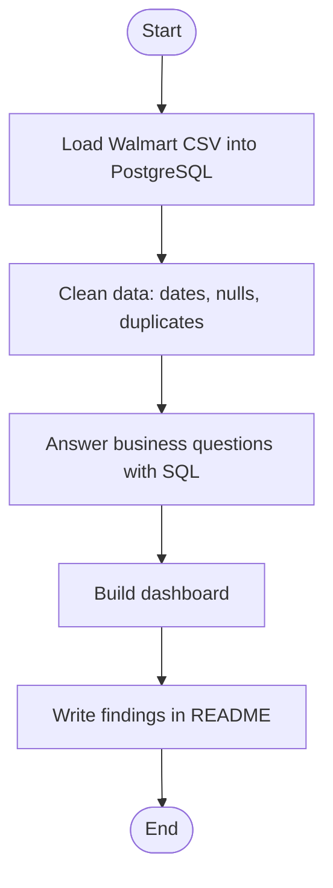
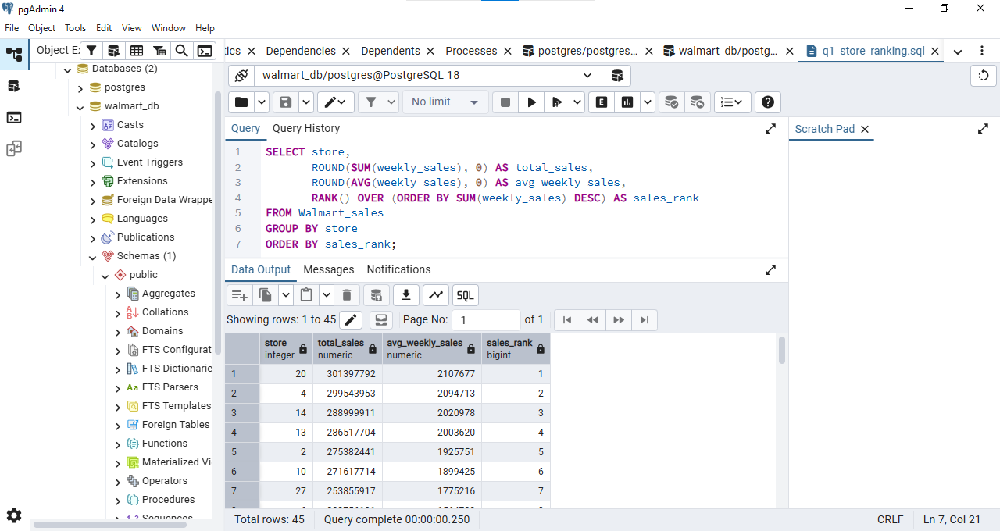
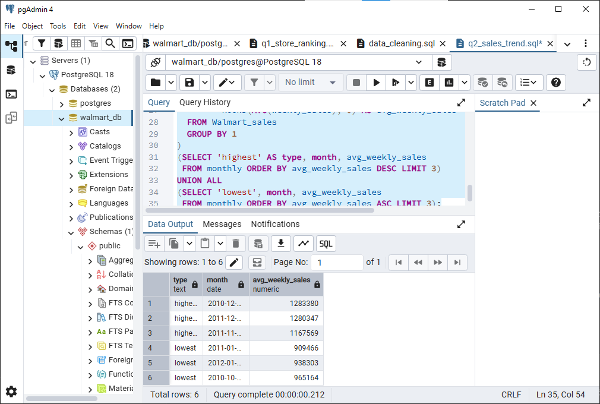
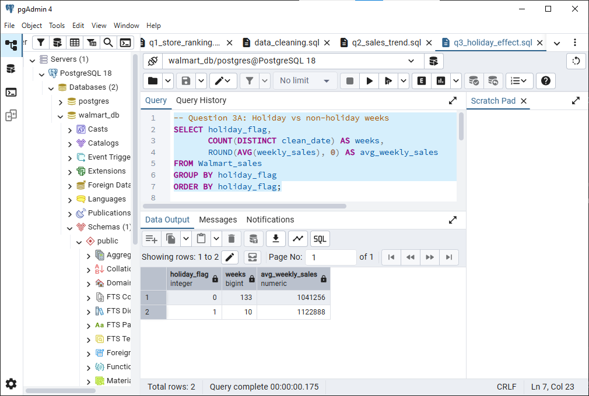
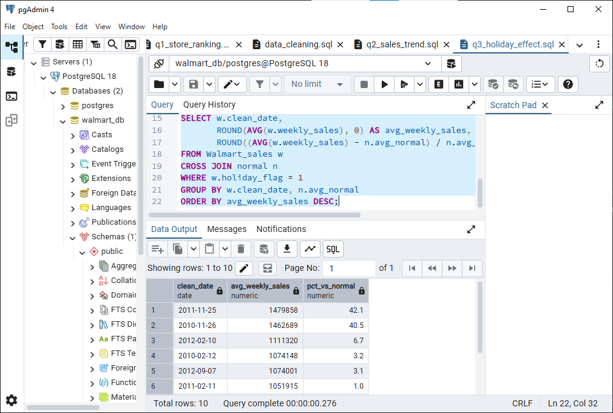
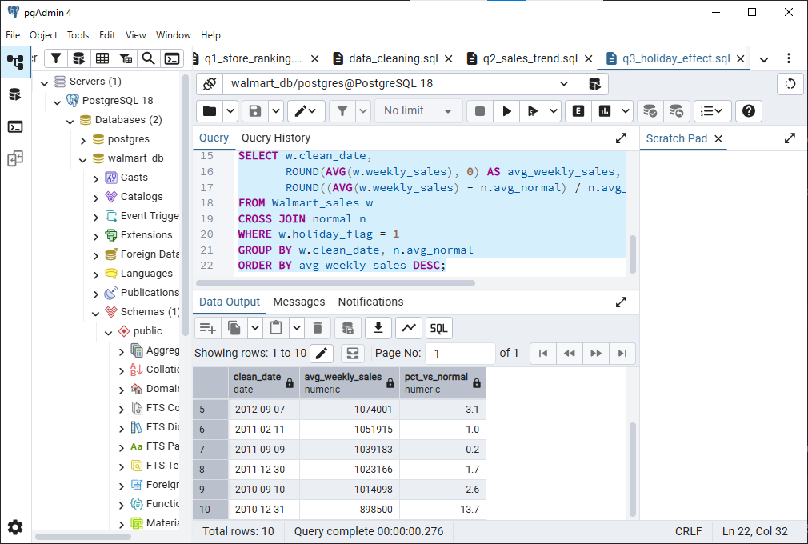
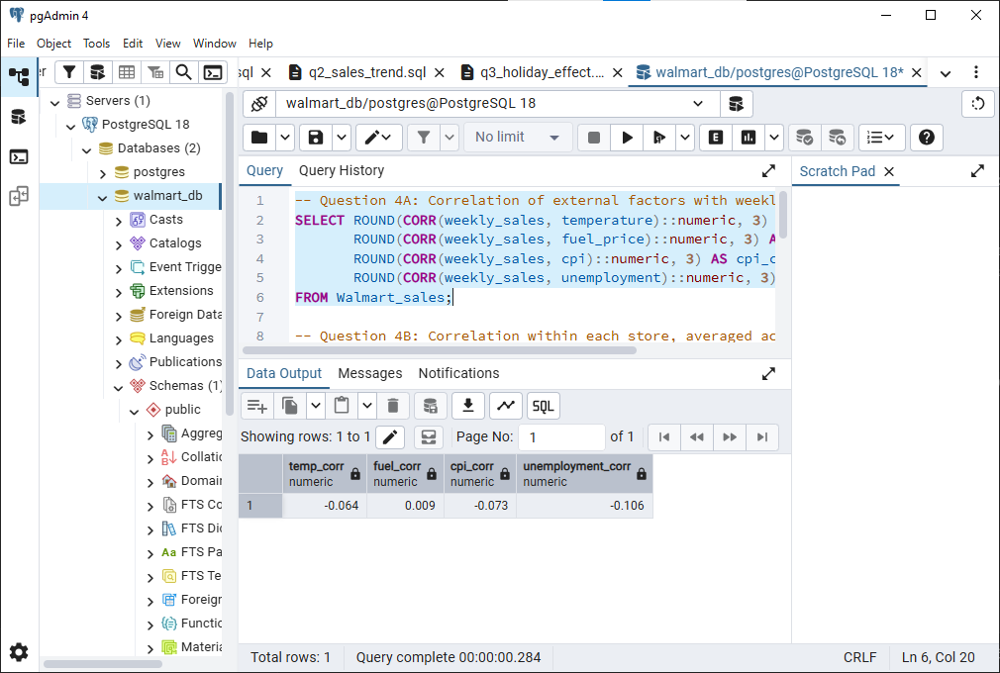
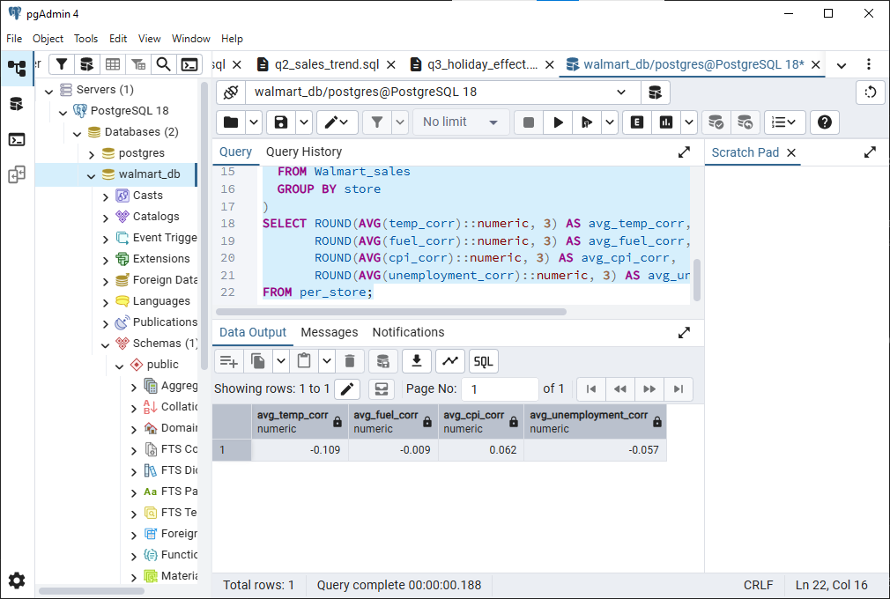
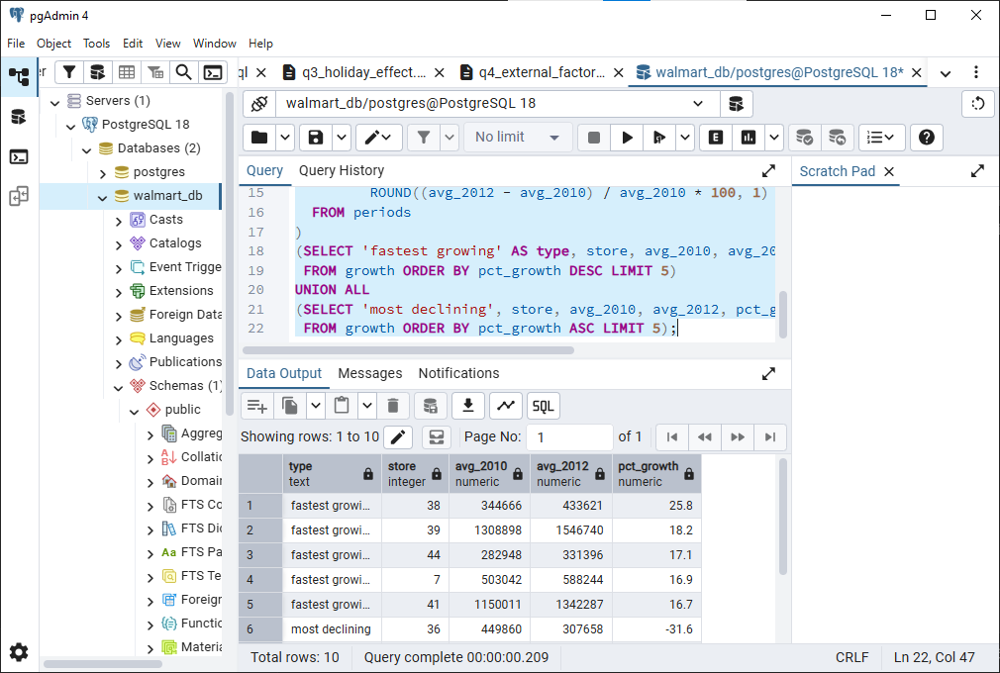

# Walmart Sales Analysis (SQL)

Analysis of Walmart weekly sales data using PostgreSQL.

## Dataset
- Source: Kaggle (Walmart sales dataset)
- 6,435 rows, 45 stores, weekly data from 5 Feb 2010 to 26 Oct 2012
- Columns: store, sale_date, weekly_sales, holiday_flag, temperature, fuel_price, cpi, unemployment

## Tools
PostgreSQL 18, pgAdmin 4

## Project Workflow

## Data Cleaning
See `data_cleaning.sql`.
- Converted `sale_date` from text to a proper date column (`clean_date`)
- Checked for duplicate store/week rows: none found
- Checked for null values: none found
- Checked value ranges: all realistic (temperature appears to be in Fahrenheit)

## Business Questions

### Q1: Which stores generate the most sales?
See `q1_store_ranking.sql`.

**Finding:** Store 20 ranks first with about 301.4M in total sales (about 2.11M per week), followed by Store 4 (about 299.5M) and Store 14 (about 289.0M).

### Q2: How do sales change over time?
See `q2_sales_trend.sql`.

**Yearly:** Average weekly sales per store were about 1.06M in 2010, 1.05M in 2011 and 1.03M in 2012. 2010 covers 48 weeks and 2012 only 43 (data ends in October), so average weekly sales are used instead of totals.

**Monthly:** Sales peak in November and December (Dec 2010 about 1.28M, Dec 2011 about 1.28M, Nov 2011 about 1.17M) and are lowest in January (Jan 2011 about 0.91M, Jan 2012 about 0.94M), consistent with holiday-season shopping.

### Q3: Do holiday weeks sell more than normal weeks?
See `q3_holiday_effect.sql`.

**Finding:** Holiday weeks averaged about 1.12M per store per week against 1.04M for normal weeks (about 7.8% higher). The increase is driven mainly by the two Thanksgiving weeks (26 Nov 2010 at +40.5% and 25 Nov 2011 at +42.1% above the normal-week average). Of the 10 holiday weeks, 6 sold above the normal average and 4 below it, including both late-December weeks (31 Dec 2010 at -13.7% and 30 Dec 2011 at -1.7%). There are only 10 holiday weeks against 133 normal weeks, so the comparison is based on a small sample.

### Q4: Do temperature, fuel price, CPI or unemployment affect sales?
See `q4_external_factors.sql`.

**Method:** Pearson correlation (`CORR`) between weekly sales and each factor, first across all rows, then within each store and averaged across the 45 stores.

**Finding:** All four factors showed weak correlation with weekly sales (between -0.11 and 0.06 in both approaches), so none of them is a strong predictor on its own. Fuel price was essentially unrelated (0.009 overall, -0.009 within stores). Temperature had the largest within-store effect (-0.109), which may reflect busy winter holiday weeks rather than a direct effect of the weather. CPI changed sign between the two approaches, which suggests its effect is too small to rely on. Correlation does not show cause, and it only captures straight-line relationships.

### Q5: Which stores are growing fastest, and which are declining?
See `q5_store_growth.sql`.

**Method:** Compared each store's average weekly sales for Feb-Oct 2010 with Feb-Oct 2012. Using the same months in both years stops the November-December peak from distorting the result.

**Finding:** The fastest-growing stores were Store 38 (+25.8%), Store 39 (+18.2%), Store 44 (+17.1%), Store 7 (+16.9%) and Store 41 (+16.7%). The most declining were Store 36 (-31.6%), Store 35 (-22.4%), Store 14 (-15.4%), Store 27 (-7.3%) and Store 15 (-6.8%). Store 14 and Store 27 are among the top 10 stores by total sales (Q1), so high total sales do not guarantee growth. Stores 38, 44 and 36 have low weekly sales, so their percentage changes look large relative to the amounts involved. The data does not show why these stores changed.

## Next Steps (planned)
- Build a dashboard (Power BI or Excel) of the findings above
